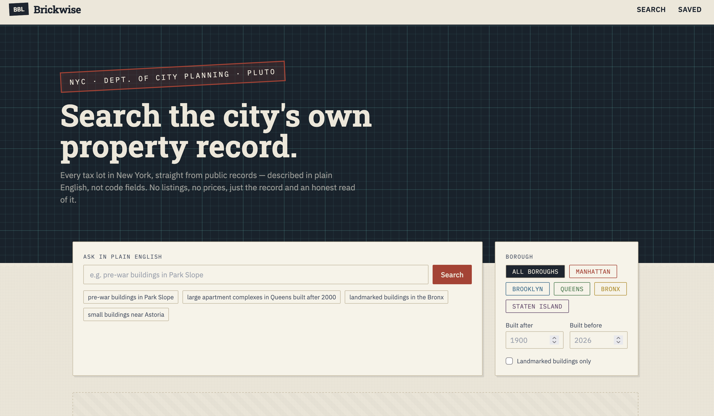

# Brickwise: AI Explorer for NYC Property Records

Search New York City's public building records in plain English. Type something like *"pre-war buildings in Park Slope"*. Brickwise turns it into a real query against NYC Open Data, plots the results on a map, and writes an AI briefing for any building you open.

**Live demo:** [luminous-caramel-127270.netlify.app](https://luminous-caramel-127270.netlify.app/)

## The problem
NYC publishes detailed data on every building in the city (PLUTO, from the Dept. of City Planning), but it's hard to use unless you know databases and the city's codes. Brickwise lets anyone ask a normal question and get clear answers on a map.

## How it works
1. **Ask**: the user types a question in plain English.
2. **Translate**: Claude (Anthropic API) converts the question into a structured query: borough, neighborhood, year built, number of units and landmark status.
3. **Fetch**: the app pulls matching records live from NYC Open Data.
4. **Show**: results appear as cards and on an interactive map.
5. **Explain**: open any building to get an AI-written briefing based only on that building's real data.

## Features
- Natural-language search over real NYC property records
- Interactive map with building locations (Leaflet)
- Filters and borough tabs
- AI-generated briefings for each property, grounded in fetched data
- Save favorite buildings
- API key kept on the server in secure API routes, never sent to the browser

## Tech stack
| Part | Tool |
|---|---|
| Framework | Next.js 14 (React, TypeScript) |
| Styling | Tailwind CSS |
| Maps | Leaflet / React-Leaflet |
| AI | Claude via the Anthropic API |
| Data | NYC Open Data (PLUTO) |
| Hosting | Netlify (serverless) |

## Run it yourself
1. Clone this repo and run `npm install`.
2. Copy `.env.example` to `.env.local` and add your `ANTHROPIC_API_KEY`.
3. Run `npm run dev` and open http://localhost:3000.

## Project structure
- `app/`: pages and server API routes (`/api/search`, `/api/insight`)
- `components/`: map, search, filters, property cards
- `lib/`: NYC Open Data client (`pluto.ts`) and Claude client (`claude.ts`)

## Author
**Fathika Aymen**, MS in Information Technology, St. Francis College
[LinkedIn](https://www.linkedin.com/in/fathika-aymen-b05b811a2) · [GitHub](https://github.com/aymenfathika-oss)
